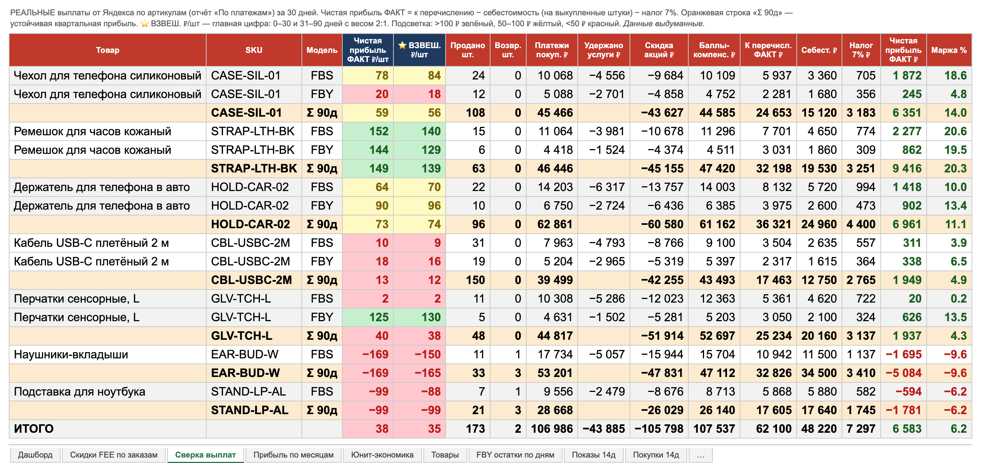
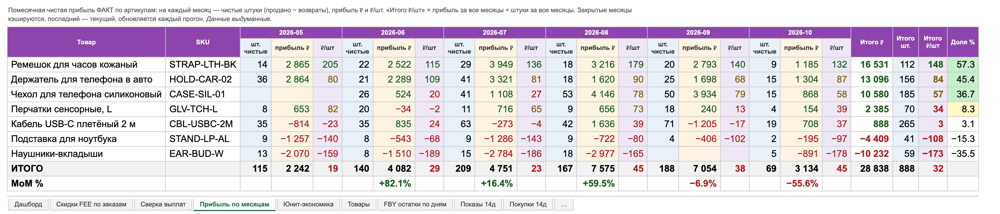

# ym-agent — аналитика продавца Яндекс Маркета

Раз или два в день собирает данные из Partner API и строит Excel-отчёт: сколько
**реально** зарабатывает каждый артикул после комиссий, буста, баллов,
себестоимости и налога — по тому, что Яндекс фактически перечислил.



<sub>Скриншоты на выдуманных данных; пересобрать — `python3 docs/make_screenshots.py`.</sub>

## Установка одной командой

Нужен [uv](https://docs.astral.sh/uv/) (`curl -LsSf https://astral.sh/uv/install.sh | sh`).

```bash
uv tool install git+https://github.com/surgaev/yandex-market-agent-public
ym-agent init
```

`init` создаст в `~/.ym-agent/` два файла:

- `.env` — ключ API и ID кабинета (подсказки, где их взять, внутри);
- `cost_prices.csv` — закупочные цены: `артикул,цена`, можно править в Excel.
  Префикс покрывает все варианты: `ABC123` → `ABC123-red`, `ABC123-xl`.

Заполните их и запускайте:

```bash
ym-agent run              # отчёт за сегодня → ~/Downloads/ym_report_ГГГГ-ММ-ДД.xlsx
ym-agent run --en0        # macOS: в обход VPN, если он режет доступ к API
```

Попробовать без установки: `uvx --from git+https://github.com/surgaev/yandex-market-agent-public ym-agent init`.
Обновиться: `uv tool upgrade ym-agent`. Вместо uv подойдёт `pipx install git+…`.

Ключ API создаётся в кабинете продавца: Настройки → API и модули. Нужны доступы
к статистике, финансам, заказам, товарам и остаткам, продвижению.

Первый прогон долгий: отчёт «По платежам» генерируется на стороне Яндекса, а
помесячная история набирается в кэши в `~/.ym-agent/`.

## Что в отчёте

- **Сверка выплат** — чистая прибыль на штуку по каждому артикулу за 30 и 90 дней
  по отчёту «По платежам» (united-netting): что Яндекс реально перечислил, минус
  себестоимость и налог. Взвешенная оценка (0–30 дней ×2, 31–90 дней ×1).
- **Прибыль по месяцам** — штуки, прибыль и ₽/шт по месяцам и итого за период;
  закрытые месяцы кэшируются.

  

- **Юнит-экономика** — разбор комиссий на штуку, стоимость буста, предел ставки.
- **Скидки FEE по заказам** — где скидка за участие в акциях не покрыла размещение.
- **Воронка** — показы, клики, корзины, покупки по дням (14 дней), «дырявая воронка».
- **Остатки FBS/FBY** — динамика по дням, на сколько дней хватит, что дозаказать.
- **Ставки буста по дням**, индекс цен, логистика по регионам, качество карточек и отзывы.

## Методика прибыли

`прибыль = К перечислению − себестоимость × (продано − возвраты) − налог 7% × выручка`

- Себестоимость списывается только с выкупленных штук: возврат уезжает на склад.
- Окна отчёта «По платежам» у Яндекса пересекаются (в выгрузку попадают и более
  ранние операции), поэтому строки фильтруются строго по дате операции.
- Буст оплачивается частично с бонусного баланса — колонка «Буст NET» показывает
  только денежную часть.
- Ставка налога — `YM_TAX_RATE` в `.env` (по умолчанию 0.07).

## Расписание на macOS

Шаблон — `launchd/ym-analytics.plist.example`: подставьте путь из `which ym-agent`,
скопируйте в `~/Library/LaunchAgents/` и загрузите через `launchctl load`.

## Разработка

```bash
git clone https://github.com/surgaev/yandex-market-agent-public && cd yandex-market-agent-public
uv run ym-agent run
```

## Лицензия

MIT
